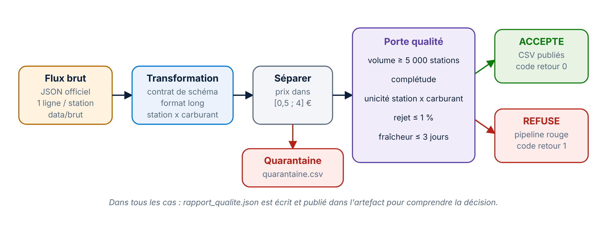

# 🗂️ Dictionnaire des données

Le pipeline lit **un flux public**, produit **quatre fichiers** et ne versionne **aucune donnée réelle** : tout est régénéré à chaque exécution. Le dossier `data/` est ignoré par Git ; seul `data/exemples/` est versionné, pour montrer le format exact des sorties.

## 1. La source

| Élément | Valeur |
|---|---|
| Producteur | Ministère de l'Économie, système d'information « Prix des carburants » |
| Jeu de données | Prix des carburants en France, flux instantané v2 |
| URL d'export | `https://data.economie.gouv.fr/api/explore/v2.1/catalog/datasets/prix-des-carburants-en-france-flux-instantane-v2/exports/json` |
| Fréquence | toutes les 10 minutes |
| Volume | environ 9 800 points de vente, une ligne par station |
| Licence | Licence Ouverte Etalab : réutilisation libre avec mention de la source |

**Colonnes lues dans le flux** (contrat de schéma vérifié par `transformation.verifier_contrat`) :

| Colonne | Obligatoire | Rôle |
|---|---|---|
| `id` | oui | identifiant unique de la station |
| `cp` | oui | code postal (texte ou nombre selon les jours) |
| `ville` | oui | commune |
| `adresse`, `departement`, `code_departement`, `region` | non | localisation ; le département est déduit du code postal s'il manque |
| `latitude`, `longitude` ou `geom` | non | position, normalisée en degrés |
| `<carburant>_prix` | au moins un | prix, en euros ou en millièmes d'euro selon les versions du flux |
| `<carburant>_maj` | non | horodatage de la dernière mise à jour du prix |

Carburants pris en charge : `gazole`, `sp95`, `sp98`, `e10`, `e85`, `gplc`.

Si une colonne obligatoire disparaît, le pipeline s'arrête avec l'erreur `ContratRompu`, qui affiche la liste des colonnes reçues.

## 2. Les couches

| Couche | Emplacement | Contenu | Versionnée |
|---|---|---|---|
| Brute | `data/brut/carburants_AAAAMMJJ_HHMM.json` | le flux tel que reçu, horodaté | non |
| Propre | `data/propre/` | les 4 fichiers ci-dessous | non |
| Production | `C:\PompeRadar\publication` | copie des fichiers propres, après approbation | non |
| Exemple | `data/exemples/` | sorties obtenues sur `tests/donnees_exemple.json` | oui |

## 3. Les sorties

Les fichiers CSV sont encodés en UTF-8 avec BOM, séparateur `;`, décimale `,` : ils s'ouvrent directement dans Excel en français et se chargent sans réglage dans Power BI.

### `prix_carburants.csv` : une ligne par station et par carburant

| Colonne | Type | Exemple | Règle |
|---|---|---|---|
| `station_id` | texte | `57000001` | clé avec `carburant` (unicité contrôlée) |
| `adresse` | texte | `Avenue de Strasbourg` | |
| `ville` | texte | `Metz` | mise en forme « Titre » |
| `cp` | texte | `57000` | toujours 5 caractères |
| `code_departement` | texte | `57` | 3 caractères pour l'outre-mer (`971`) |
| `departement`, `region` | texte | `Moselle`, `Grand Est` | |
| `latitude`, `longitude` | décimal | `49,1046` | degrés WGS 84 |
| `carburant` | texte | `GAZOLE` | `GAZOLE`, `SP95`, `SP98`, `E10`, `E85`, `GPLC` |
| `prix` | décimal | `1,689` | euros par litre, 3 décimales, compris entre 0,5 et 4 |
| `date_maj` | horodatage | `2026-10-27 07:15:00+00:00` | UTC |

### `synthese_departements.csv` : une ligne par département et par carburant

| Colonne | Contenu |
|---|---|
| `code_departement`, `carburant` | clé |
| `nb_stations` | nombre de stations distinctes |
| `prix_moyen`, `prix_min`, `prix_max` | statistiques de prix, en euros |

### `quarantaine.csv`

Même structure que `prix_carburants.csv`. Contient les lignes écartées : prix hors de l'intervalle [0,5 ; 4] euros, ou département impossible à déterminer. Elles sont conservées pour analyse, jamais publiées.

### `rapport_qualite.json`

```json
{
  "source": "data/brut/carburants_20261028_1715.json",
  "stations": 9264,
  "lignes_valides": 30995,
  "lignes_quarantaine": 0,
  "anomalies": [],
  "statut": "ACCEPTE"
}
```

`statut` vaut `ACCEPTE` quand la liste `anomalies` est vide ; sinon `REFUSE`, et le pipeline s'arrête avec le code retour 1.

## 4. La porte qualité



| Règle | Seuil | Ce qu'elle détecte |
|---|---|---|
| Volume | au moins 5 000 stations | flux tronqué |
| Complétude | aucune valeur vide dans `station_id`, `carburant`, `prix`, `code_departement` | colonnes cassées |
| Unicité | une ligne par station et par carburant | doublons |
| Plausibilité | au plus 1 % de lignes en quarantaine | lot suspect dans son ensemble |
| Fraîcheur | dernière mise à jour de moins de 3 jours | flux figé |

## 5. Réconcilier les volumes

Sur une exécution réelle du 28 octobre 2026 : **9 820 stations** ingérées, **9 264** avec au moins un prix publiable, **30 995** lignes station x carburant, **0** en quarantaine. L'écart entre 9 820 et 9 264 correspond aux stations qui ne déclarent aucun prix dans le flux : le format long ne conserve que les couples station x carburant dont le prix est renseigné.
