# 📘 Guide pas à pas : PompeRadar sur Azure DevOps

> Version web du guide. Version PDF imprimable : [Guide_Public_DevOps_1_PompeRadar.pdf](Guide_Public_DevOps_1_PompeRadar.pdf). Dictionnaire des données : [data/README.md](../data/README.md).

**Sommaire**

| Partie | Contenu |
|---|---|
| [Le projet en une page](#le-projet-en-une-page) | architecture, coût à 0 €, les 6 phases |
| [Les quatre schémas](#les-quatre-schémas-à-comprendre-avant-de-commencer) | zones de Git, boucle quotidienne, branches, pipeline |
| [Phase 1. Préparer](#phase-1-préparer-le-terrain) | outils, configuration Git, projet Azure DevOps |
| [Phase 2. Planifier](#phase-2-planifier-dans-azure-boards) | Epic, Feature, User Stories |
| [Phase 3. Coder](#phase-3-coder-comme-une-équipe) | premier commit, protection de main, première pull request |
| [Phase 4. Données](#phase-4-les-données-réelles-et-la-porte-qualité) | flux réel, quarantaine, porte qualité |
| [Phase 5. Industrialiser](#phase-5-industrialiser) | agent, environnement, pipeline YAML |
| [Phase 6. Git](#phase-6-latelier-git--les-8-situations-du-quotidien) | les 8 situations du quotidien |
| [Clôture](#clôture--zéro-consommation) | zéro consommation, vérifications |
| [Antisèche](#annexe--antisèche-dentretien) | questions d'entretien, dépannage |


# Le projet en une page

**Ce que vous construisez.** Un pipeline de données industrialisé comme en entreprise. Il part des **prix réels des carburants** de toutes les stations-service de France, publiés par le Ministère de l'Économie et mis à jour toutes les 10 minutes. Ces données sont téléchargées, transformées, contrôlées par une porte qualité, puis publiées en production. Toute la chaîne est pilotée par **Azure DevOps** : Boards pour le travail, Repos pour le code, Pipelines pour la CI/CD, Environments pour l'approbation.

**Ce que vous saurez faire à la fin :**
- le cycle Git du quotidien ;
- protéger une branche `main` ;
- écrire un pipeline YAML en trois stages ;
- faire tourner un agent auto-hébergé ;
- déployer avec approbation humaine ;
- relier chaque ligne de code à une User Story.

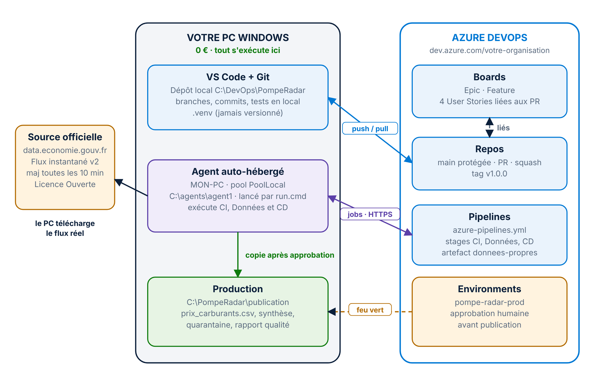

**Pourquoi le coût Azure est de 0 €.** C'est la question qu'on vous posera.
- L'organisation Azure DevOps est gratuite jusqu'à 5 utilisateurs et n'exige aucun abonnement Azure.
- Les jobs tournent sur **votre PC**, en agent auto-hébergé : c'est gratuit et sans limite de minutes.
- Aucune ressource Azure n'est créée. La « production » est un dossier de votre machine.

> **Dans le dépôt.** Tout le code est dans ce dépôt. Ce guide vous dit **quoi faire et pourquoi** ; le dépôt contient **le contenu exact** de chaque fichier. Vous les copiez au moment indiqué, sans rien retaper.

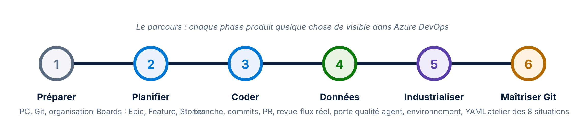

# Les quatre schémas à comprendre avant de commencer

## 1. Les quatre zones de Git

Une modification voyage de gauche à droite :
1. vous modifiez un fichier (répertoire de travail) ;
2. vous choisissez ce qui part (`git add`, zone de préparation) ;
3. vous figez une photo (`git commit`, dépôt local) ;
4. vous partagez (`git push`, dépôt distant `origin`).

Dans l'autre sens, `git fetch` rapatrie l'historique sans toucher vos fichiers, et `git pull` = `fetch` + intégration.

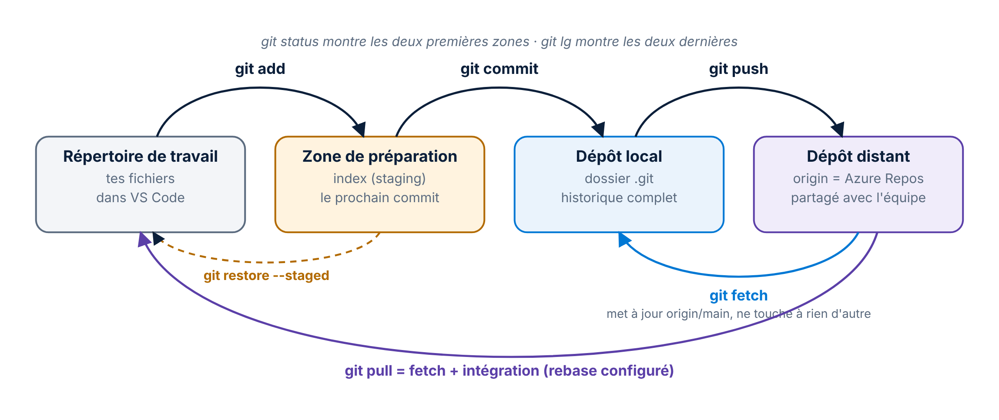

## 2. La boucle quotidienne d'une User Story

C'est **le** geste que vous répéterez toute votre carrière. Chaque fonctionnalité fait un tour complet : partir d'un `main` à jour, créer une branche courte, faire des commits atomiques, ouvrir une pull request validée par la CI et un relecteur, fusionner en squash, puis nettoyer.

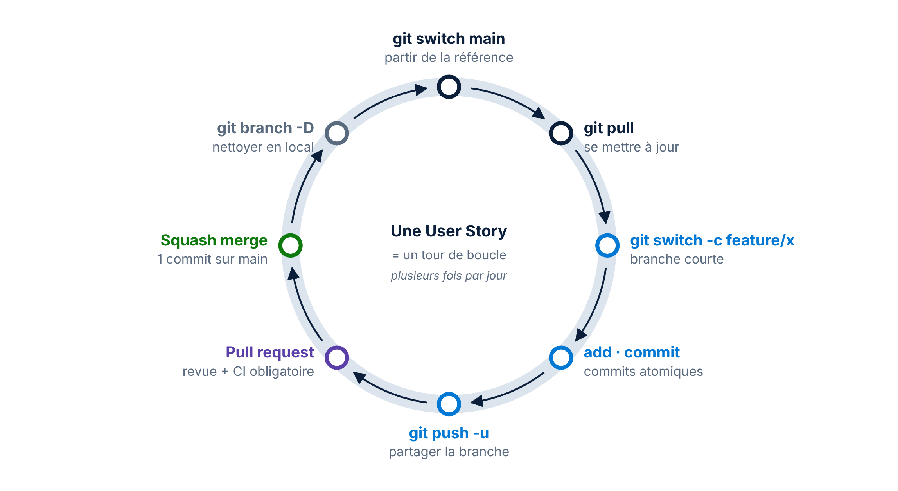

## 3. La stratégie de branches : trunk-based

`main` est toujours déployable et **protégée** : personne n'y pousse directement. Chaque User Story vit dans une branche courte qui revient par pull request, fusionnée en **squash**, c'est-à-dire en un seul commit propre. Une version stable reçoit un **tag**.

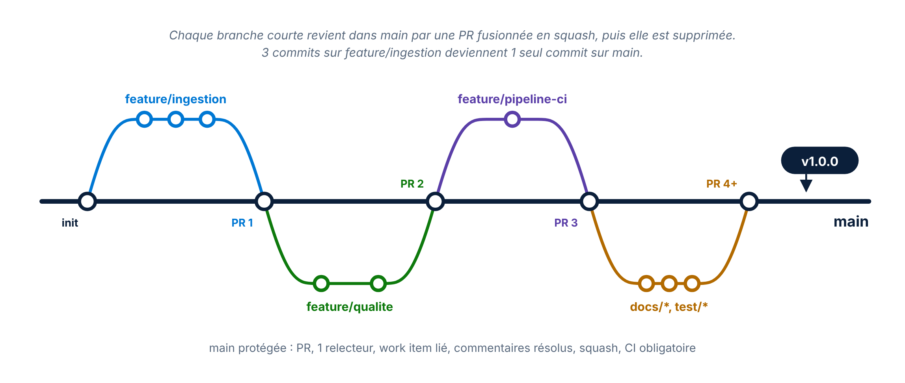

## 4. Le pipeline CI/CD

Un fichier YAML, trois stages :
- sur une **pull request**, seul le stage **CI** tourne (lint et tests) ;
- sur **main**, la chaîne complète s'enchaîne : **CI**, puis **Données** (flux réel et porte qualité), puis **CD**, qui attend votre approbation.

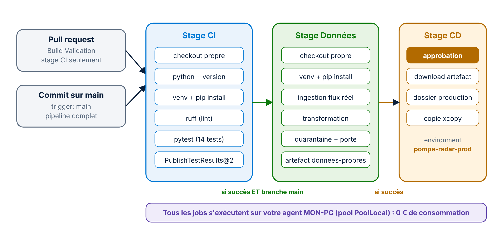

# Phase 1. Préparer le terrain

**Sur votre PC.** Vérifiez trois outils dans PowerShell. S'il en manque un, installez Git for Windows, Python 3.11+ (cochez **Add python.exe to PATH**) et VS Code.

```
git --version
python --version
code --version
```

Travaillez dans `C:\DevOps`, **jamais dans OneDrive**, qui verrouille des fichiers et casse Git et l'agent.

**Configurer Git, une fois pour toutes.** Mettez vos propres valeurs :

```
git config --global user.name "Prénom Nom"
git config --global user.email "adresse-de-votre-compte-azure-devops"
git config --global init.defaultBranch main
git config --global core.autocrlf true
git config --global core.editor "code --wait"
git config --global pull.rebase true
git config --global fetch.prune true
git config --global alias.lg "log --oneline --graph --decorate --all"
```

| Réglage | Pourquoi |
|---|---|
| `pull.rebase true` | `git pull` rejoue vos commits au-dessus du distant : historique linéaire |
| `fetch.prune true` | les branches supprimées sur le serveur disparaissent aussi chez vous |
| `alias.lg` | `git lg` affiche le graphe complet des branches |

**Créer le projet Azure DevOps.**
1. Sur **dev.azure.com**, créez une organisation (ou utilisez la vôtre), puis **New project**.
2. Nom : `PompeRadar`, visibilité **Private**.
3. Dans **Advanced** : **Git** et **Agile**. Avec Basic, vous n'auriez ni Feature ni User Story.
4. Vérifiez **Organization settings > Billing** : *Paid parallel jobs* à **0**. Ne cliquez ni **Set up billing**, ni **Start free trial**.

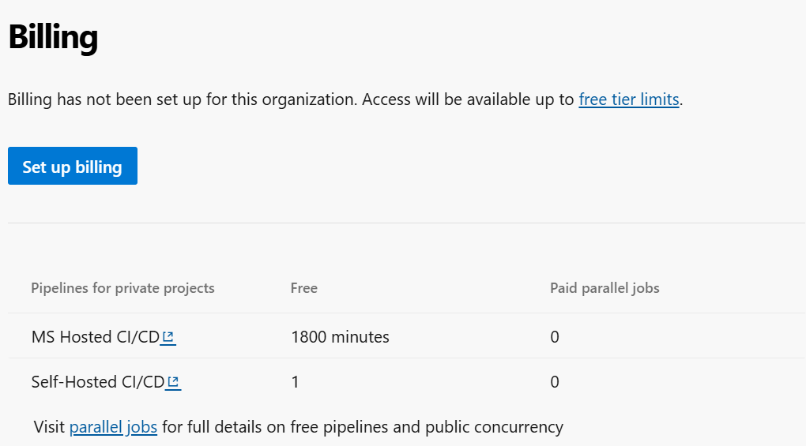

*Résultat attendu : facturation non configurée, 0 job payant. Rien ne peut être facturé.*

# Phase 2. Planifier dans Azure Boards

En entreprise, on ne code rien sans élément de travail.

1. **Boards > Backlogs**.
2. Si le niveau **Epics** n'apparaît pas dans le menu des niveaux, activez-le : engrenage, onglet **Backlogs**, cochez **Epics**.
3. Créez la hiérarchie ci-dessous. Le **+** à gauche d'un élément crée son enfant.

| Type | Titre |
|---|---|
| Epic | PompeRadar : prix des carburants en temps réel |
| Feature | Pipeline de données industrialisé |
| User Story | Ingestion et transformation du flux officiel |
| User Story | Quarantaine et porte qualité |
| User Story | Pipeline CI/CD multi-étapes |
| User Story | Atelier Git : maîtrise du quotidien |

> **Résultat attendu.** En vue **Epics**, l'arbre dépliable montre l'Epic, la Feature dessous, puis les 4 User Stories sous la Feature.

Chaque pull request sera reliée à sa User Story : vous tapez le début du titre dans **Work items to link**. La traçabilité va ainsi du besoin jusqu'à la production.

# Phase 3. Coder comme une équipe

La carte du dépôt, à garder sous les yeux : chaque fichier, son rôle.

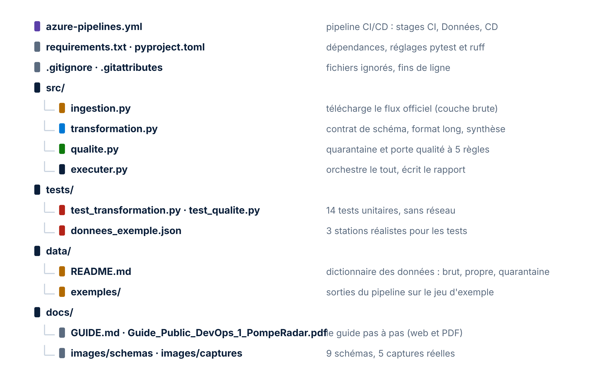

## Premier commit et protection de main

1. **Repos > Files > Clone** : copiez l'URL HTTPS, puis :

```
cd C:\DevOps
git clone <URL-de-votre-depot>
cd PompeRadar
code .
```

2. Copiez depuis le dépôt GitHub les cinq fichiers racine : `.gitignore`, `.gitattributes`, `README.md`, `requirements.txt`, `pyproject.toml`. **Ctrl+S** après chacun.
3. Premier commit :

```
git add .
git commit -m "chore: initialisation du dépôt PompeRadar"
git push -u origin main
```

> **Résultat attendu.** **Repos > Commits** affiche votre commit avec votre nom d'auteur.

4. Protégez `main` : **Repos > Branches > main > ... > Branch policies**.

| Stratégie | Réglage |
|---|---|
| Minimum number of reviewers | 1, et cochez *Allow requestors to approve their own changes* si vous êtes seul |
| Check for linked work items | Required |
| Check for comment resolution | Required |
| Limit merge types | Squash merge uniquement |


## La première User Story, de bout en bout

Faites un **tour de boucle** complet :

```
git switch main
git pull
git switch -c feature/ingestion
python -m venv .venv
.venv\Scripts\python.exe -m pip install -r requirements.txt
```

1. Copiez [`src/ingestion.py`](../src/ingestion.py), puis faites un commit `feat(ingestion): …`.
2. Copiez [`src/transformation.py`](../src/transformation.py), puis un commit `feat(transformation): …`.
3. Copiez [`tests/donnees_exemple.json`](../tests/donnees_exemple.json) et [`tests/test_transformation.py`](../tests/test_transformation.py), puis un commit `test(transformation): …`.

Un fichier par commit : ce sont des **commits atomiques**. Avant chaque commit, lancez :

```
.venv\Scripts\python.exe -m pytest
.venv\Scripts\python.exe -m ruff check src tests
```

Poussez avec `git push -u origin feature/ingestion`, puis ouvrez la **pull request** et liez la User Story.

> **Résultat attendu.** `6 passed` puis `All checks passed!` (puis 14 tests à la phase 4). La barre d'état de VS Code affiche la branche `feature/ingestion`.

Dans l'onglet **Files** de la PR, posez un commentaire sur une ligne (la bulle à gauche du numéro de ligne), répondez-y, puis cliquez **Reply & resolve**. Ensuite **Approve**, puis **Complete** en **Squash commit**, en supprimant la branche et en fermant le work item.

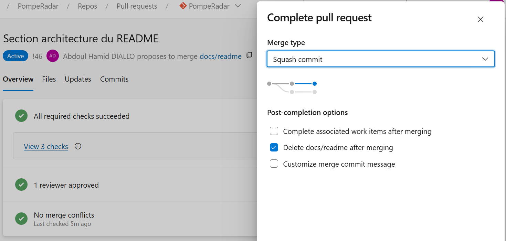

*Avant Complete : les trois contrôles verts (CI, relecteur, aucun conflit), puis Squash commit et suppression de la branche.*

```
git switch main
git pull
git branch -D feature/ingestion
```

> **Résultat attendu.** `git lg` montre un seul commit « Merged PR … » sur `main`, et la User Story est passée en **Closed** dans Boards.

> **Gourou.** Après un squash, Git ne considère plus la branche locale comme fusionnée : d'où `-D` majuscule. Et retenez **Conventional Commits** : `feat`, `fix`, `test`, `docs`, `ci`, `chore`, `refactor`.

# Phase 4. Les données réelles et la porte qualité

Un ingénieur data ne publie **jamais** une donnée non contrôlée. Le pipeline sépare les lignes publiables des lignes en **quarantaine**, puis une **porte qualité** décide si le lot entier part en production.


| Règle | Seuil | Si violée |
|---|---|---|
| Volume | au moins 5 000 stations | le flux est tronqué |
| Complétude | aucune valeur vide dans les clés | colonnes cassées |
| Unicité | 1 ligne par station et carburant | doublons |
| Plausibilité | moins de 1 % de prix rejetés | lot suspect |
| Fraîcheur | mise à jour de moins de 3 jours | flux figé |

1. Branche `feature/qualite`.
2. Copiez [`src/qualite.py`](../src/qualite.py) et [`tests/test_qualite.py`](../tests/test_qualite.py). Attendu : **14 tests réussis**.
3. Copiez [`src/executer.py`](../src/executer.py), puis lancez le **premier passage sur le flux réel** :

```
.venv\Scripts\python.exe src\executer.py
explorer data\propre
```

Vous lisez alors les cinq gazoles les moins chers de Moselle, puis « Porte qualité franchie », avec environ 9 800 stations ingérées. Dans `data\propre` : `prix_carburants.csv`, `synthese_departements.csv`, `quarantaine.csv` et `rapport_qualite.json`.

> **Gourou.** La transformation **répare à la source** ce qui peut l'être. Par exemple, un code département absent est déduit du code postal. Ce qui reste irréparable part en **quarantaine**, tracé et conservé, au lieu de bloquer des milliers de lignes saines. Chaque correctif a son test de non-régression.

Les données ne se versionnent pas : elles se **régénèrent**. Le dossier `data` est ignoré par Git.

# Phase 5. Industrialiser

## L'agent auto-hébergé

| Étape | Où | Valeur |
|---|---|---|
| Créer le pool | Organization settings > Agent pools > Add pool | Self-hosted, `PoolLocal`, cochez *Grant access permission to all pipelines* |
| Créer un jeton | User settings > Personal access tokens | scope **Agent Pools : Read & manage**, 30 jours |
| Télécharger | PoolLocal > New agent > Windows x64 | décompresser dans `C:\agents\agent1` |

Dans un **PowerShell séparé** :

```
cd C:\agents\agent1
.\config.cmd
.\run.cmd
```

Répondez aux questions de `config.cmd` :
- l'URL de votre organisation ;
- **Entrée** pour PAT, puis collez le jeton (rien ne s'affiche, c'est normal) ;
- le pool `PoolLocal` ;
- un nom d'agent ;
- **Entrée** pour le dossier de travail ;
- **N** pour le service, **N** pour l'autologon.

Attendu : **« à l'écoute des travaux »**, et l'agent apparaît **Online** dans **Agent pools > PoolLocal > Agents**. Supprimez ensuite le jeton de tout fichier où vous l'auriez noté.

## L'environnement de production

**Pipelines > Environments > New environment** : `pompe-radar-prod`, ressource **None**. Ajoutez ensuite **Approvals and checks > Approvals**, avec vous comme approbateur.

## Le pipeline YAML

1. Branche `feature/pipeline-ci`.
2. Copiez [`azure-pipelines.yml`](../azure-pipelines.yml) depuis le dépôt et poussez.
3. **Pipelines > Create Pipeline > Azure Repos Git > Existing Azure Pipelines YAML file**, puis **Run**. Sur la branche, seul le stage CI tourne : Données et CD sont *Skipped*.

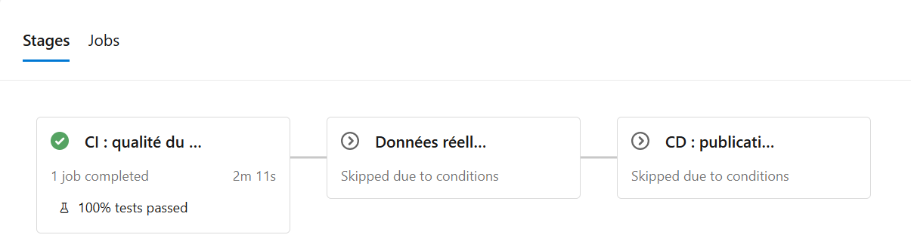

*Sur une branche de fonctionnalité : CI verte, 100 % des tests réussis, Données et CD sautés par la condition « main uniquement ».*

| Élément du YAML | Ce qu'il fait |
|---|---|
| `trigger` + `paths: exclude` | lance sur `main`, sauf si seuls `README.md` ou le dossier `docs` changent |
| `pool: name: PoolLocal` | envoie les jobs sur votre agent |
| `condition: … refs/heads/main` | le stage Données ne tourne **que** sur `main` |
| `condition: succeededOrFailed()` | publie le rapport qualité **même si** la porte refuse |
| `deployment` + `environment` | le stage CD attend l'approbation humaine |

Branchez enfin la CI sur la protection de `main` : **Branch policies > Build Validation > +**, pipeline **PompeRadar**, **Required**, nom `CI obligatoire`. Puis ouvrez la PR. La fusion lance la chaîne complète. Quand CD affiche **Waiting**, ouvrez l'artefact `donnees-propres`, vérifiez que `rapport_qualite.json` indique **ACCEPTE**, puis cliquez **Review > Approve**.

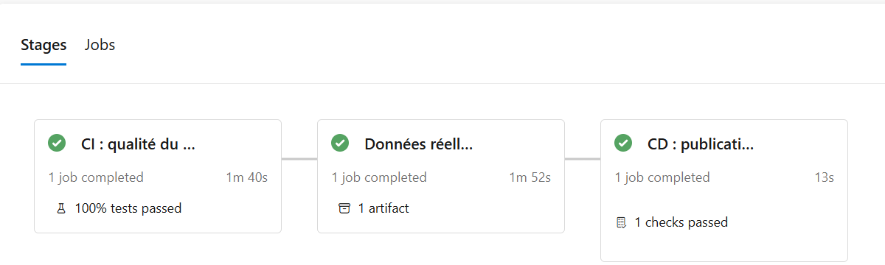

*Sur main, après approbation : CI, Données (1 artefact) et CD (1 contrôle réussi), le tout exécuté sur l'agent local.*

> **Question d'entretien classique.** Avec Azure Repos, le déclenchement sur pull request ne se règle **pas** avec le mot-clé YAML `pr:`, qui ne sert que pour GitHub et Bitbucket. On passe par la **Build Validation** des stratégies de branche.

# Phase 6. L'atelier Git : les 8 situations du quotidien

Faites ces exercices sur votre vrai dépôt, rattachés à la User Story **Atelier Git**.

| # | Situation | Commandes clés | À retenir |
|---|---|---|---|
| A | Faute dans le dernier message | `git commit --amend -m "…"` | remplace le commit (nouveau SHA) : avant le push uniquement |
| B | Urgence pendant un travail en cours | `git stash push -m "…"` puis `git stash pop` | `pop` réapplique et vide le stash ; `apply` le garde |
| C | Commits « wip » à nettoyer | `git rebase -i HEAD~3`, puis `squash` | `pick`, `squash`, `fixup`, `reword`, `drop` |
| D | Conflit avec main | `git fetch`, `git rebase origin/main`, résoudre, `git add`, `git rebase --continue`, `git push --force-with-lease` | en rebase, HEAD est la branche **cible** |
| E | Annuler ce qui est sur main | bouton **Revert** sur la PR terminée | nouveau commit inverse ; jamais `reset` sur une branche partagée |
| F | Marquer une version | `git tag -a v1.0.0 -m "…"` puis `git push origin v1.0.0` | `push` n'envoie jamais les tags tout seul |
| G | Commit « perdu » après un `reset --hard` | `git reflog` puis `git reset --hard 'HEAD@{1}'` | guillemets obligatoires dans PowerShell ; le reflog est local |
| H | Recopier un seul commit | `git cherry-pick <sha>` | même changement, nouveau SHA |

**Le scénario du conflit (D)** se monte en deux branches qui modifient la même ligne du README. La première est fusionnée ; la seconde est rejouée par rebase :

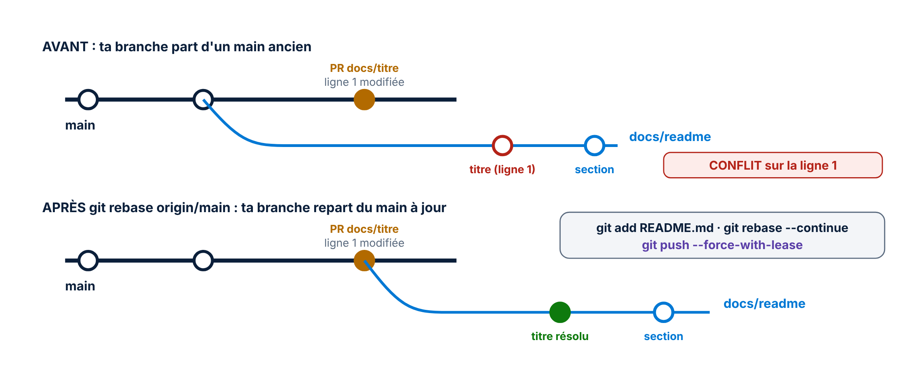

> **Gourou.** `--force-with-lease` refuse d'écraser si quelqu'un a poussé entre-temps ; `--force` écrase aveuglément. Règle d'or : on ne réécrit l'historique **que** de sa propre branche.

# Clôture : zéro consommation

1. **Boards :** fermez la dernière User Story, puis la Feature, puis l'Epic. Les parents ne se ferment jamais automatiquement : c'est une décision métier.
2. **Agent :** **Ctrl+C** dans la fenêtre `run.cmd`. L'agent passe **Offline**.
3. **Exécutions en attente :** approuvez la plus récente et rejetez les plus anciennes.
4. **Vérification finale :**

```
git status
git lg
```

Attendu : *working tree clean* et un historique en ligne droite, avec un commit par pull request et le tag `v1.0.0`.

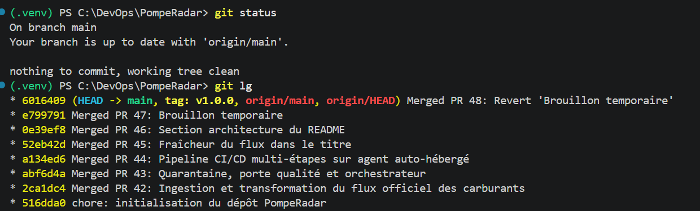

*L'état final : dépôt propre, synchronisé avec origin/main, un commit par pull request, tag v1.0.0.*

| Résultat | Où le constater |
|---|---|
| 14 tests publiés à chaque exécution | Pipelines > exécution > Tests |
| Données validées en production | `C:\PompeRadar\publication` |
| Qui a déployé quoi, et quand | Pipelines > Environments > pompe-radar-prod |
| Quels commits sont partis | exécution > Changes |
| Du besoin au code | Boards : chaque story liée à sa PR |

# Annexe : antisèche d'entretien

| Question | Réponse courte |
|---|---|
| fetch ou pull ? | `fetch` rapatrie sans toucher ; `pull` = `fetch` + intégration |
| merge ou rebase ? | merge relie sans réécrire ; rebase rejoue et linéarise, mais réécrit les SHA |
| reset ou revert ? | reset déplace la branche (local) ; revert ajoute un commit inverse (partagé) |
| Les 3 fusions d'une PR ? | Merge, Squash, Rebase and fast-forward |
| Stage, job, step, task ? | stage groupe des jobs ; un job tourne sur un agent ; un step est un script ou une task |
| Microsoft-hosted ou self-hosted ? | simplicité, ou contrôle, coût et réseau interne |
| Un secret dans un pipeline ? | jamais dans le YAML : variable secrète, groupe relié à Key Vault, connexion de service |
| `!47` et `#16` ? | `!` cite une pull request, `#` cite un work item |
| Trunk-based ou GitFlow ? | branches courtes et livraisons fréquentes, ou develop, release et hotfix |
| Pourquoi des tests sans réseau ? | rapides, déterministes, reproductibles |

**Dépannage express :**

| Symptôme | Remède |
|---|---|
| TF402455 au push sur main | normal : passez par une branche et une PR |
| `pathspec did not match` | le fichier est ailleurs ou mal nommé : `git status` |
| Job bloqué en *Queued* | l'agent est arrêté : `.\run.cmd` |
| *needs permission to access a resource* | **View > Permit** |
| *0 of 1 reviewers approved* | cliquez **Approve** avant **Complete** |
| Rebase qui tourne mal | `git rebase --abort` |

